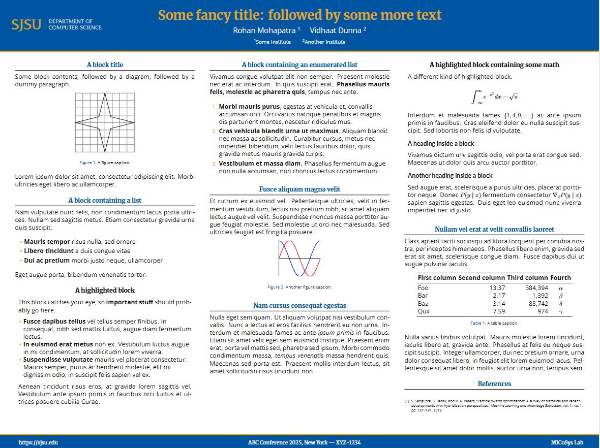

# SJSU Poster LaTeX Template
The template can be downladed as a zip and used on [Overleaf](overleaf.com), or built locally.
It would look something like this:  

## Authors:
- Rohan Mohapatra [rohanmohapatra](https://github.com/rohanmohapatra)
- Edited by Vidhaat Dunna [atenine](https://github.com/atenine)